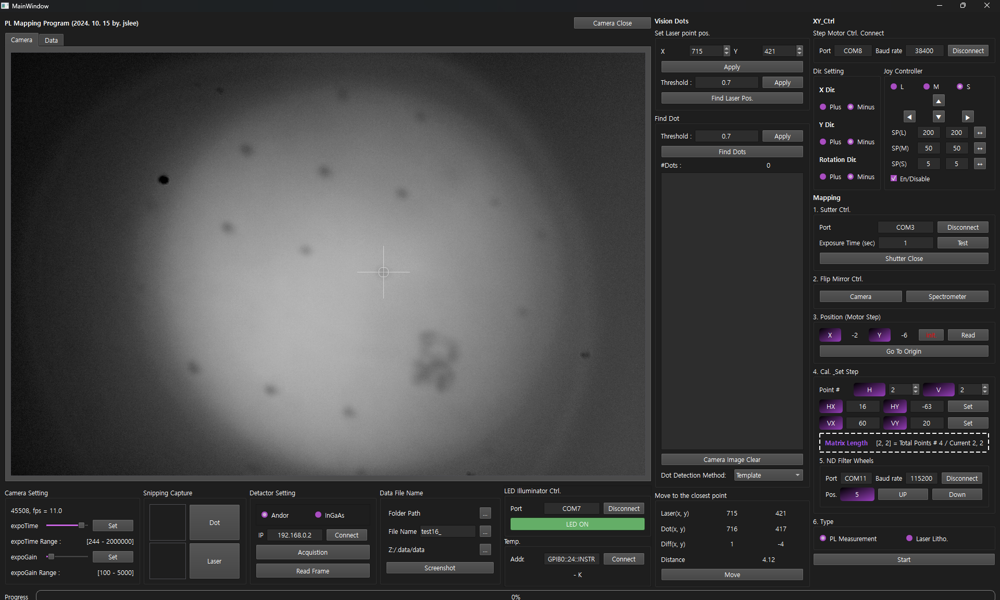

# Mapping Vision · PL Mapping Program

카메라 영상에서 시료의 점과 레이저 위치를 찾고, XY 스테이지와 광학 장치를 제어해 **PL(광발광) 매핑과 스펙트럼 측정**을 수행하는 Windows용 PyQt6 애플리케이션입니다. 레이저 리소그래피, 자동 초점 조정, YOLO 기반 점 검출 기능도 포함합니다.

## 화면 미리보기



*실제 장비 연결 상태에서 촬영한 메인 화면입니다. 촬영 시점과 현재 코드의 UI에는 차이가 있으며, 현재 코드는 Andor SDK2 측정 창과 자동 초점 제어 등을 추가로 제공합니다. [원본 크기로 보기](screenshots/1.png)*

| 화면 영역 | 할 수 있는 작업 |
| --- | --- |
| **Camera / Data** — 왼쪽 | 실시간 카메라 영상과 측정 스펙트럼 확인 |
| **Vision Dots** — 가운데 | 레이저 기준 좌표 설정, 점 검출, 검출 좌표 확인, 가장 가까운 점으로 이동 |
| **XY_Ctrl** — 오른쪽 위 | 스테이지 연결, 이동 방향과 스텝 크기 설정, 수동 이동 |
| **Mapping** — 오른쪽 | 셔터·플립 미러·필터 휠 제어, 그리드 설정, 매핑 및 리소그래피 시작 |
| **하단 설정 영역** | 노출·게인, 검출용 템플릿 캡처, 검출기 선택, 저장 경로·파일명, LED·온도 제어 |

## 주요 기능

- **카메라 및 비전**: NNCAM 실시간 영상, 노출·게인 조정, Template / YOLO 점 검출, 레이저 위치 검출과 정렬.
- **스테이지 제어**: DS102 시리얼 통신, XY 이동과 위치 조회, 원점 이동, 점 검출 수를 이용한 자동 초점 조정.
- **PL 매핑**: H/V 그리드와 이동 벡터를 이용한 지그재그 스캔, 위치별 스펙트럼·이미지 저장, 확장 매핑.
- **스펙트럼 측정**: Andor SOLIS 연동, Andor SDK2 직접 취득, 별도 서버를 사용하는 InGaAs 경로.
- **광학 장치 제어**: LED, 셔터, Thorlabs MFF101 플립 미러, FW102C 필터 휠, ITC503 온도 읽기.
- **레이저 리소그래피**: 스테이지 이동과 셔터 제어를 조합한 패턴 작업.

## 설치 및 실행

### 1. 실행 환경 준비

메인 프로그램은 `pywin32`와 장비 DLL을 사용하는 **Windows 환경**을 전제로 합니다. Python과 장비 DLL의 32/64비트를 맞춰야 합니다. Andor SDK2의 기본 DLL은 `atmcd64d.dll`입니다.

프로젝트 루트에서 다음 명령을 실행합니다. 아래는 가상환경을 사용하는 설치 예시이며, 장비 드라이버와 SDK는 별도로 설치해야 합니다.

```powershell
python -m venv .venv
.\.venv\Scripts\python.exe -m pip install --upgrade pip
.\.venv\Scripts\python.exe -m pip install PyQt6 numpy scipy opencv-python pyserial pyvisa pywin32 matplotlib qbstyles Pillow sif-parser pylablib ultralytics
```

`requirements_pylablib.txt`는 일부 장비·학습 관련 의존성 목록입니다. 메인 GUI에 필요한 패키지 전체를 포함하지 않으므로 이 파일만으로 설치를 마칠 수는 없습니다.

### 2. 장비 연결 준비

| 장치 / 기능 | 준비할 항목 |
| --- | --- |
| NNCAM 카메라 | 카메라 드라이버 설치 후 SDK의 `nncam.dll`을 `sub_py/`에 배치 |
| DS102 XY 스테이지 | 장치의 COM 포트와 통신 속도. 현재 메인 프로그램은 시리얼 연결을 사용 |
| LED / 셔터 / 초점용 모터 | 각 컨트롤러의 COM 포트와 통신 설정 |
| Thorlabs MFF101 | 장치 드라이버, 실제 장치와 일치하는 일련번호 |
| FW102C 필터 휠 | COM 포트와 통신 속도 |
| ITC503 | VISA 런타임과 GPIB 주소 |
| Andor SOLIS | 설치·실행된 SOLIS와 측정 파일 저장 경로 |
| Andor SDK2 | SDK2 드라이버, DLL, 공식 Python 래퍼 `pyAndorSDK2` |
| InGaAs 서버 연동 | 별도 측정 서버와 UI의 IP 설정 |

Andor SDK2가 기본 경로 외에 설치되어 있다면 실행할 PowerShell에서 다음 환경 변수를 설정합니다.

```powershell
$env:ANDOR_SDK = "C:\Program Files\Andor SDK"
$env:ANDOR_PYANDOR_SDK2 = "C:\Program Files\Andor SDK\Python\pyAndorSDK2"
```

### 3. 프로그램 실행

```powershell
.\.venv\Scripts\python.exe main.py
```

템플릿 이미지와 설정 파일을 상대 경로로 읽으므로 **프로젝트 루트를 작업 폴더로 두고 실행**합니다.

Andor SDK2의 별도 테스트 GUI는 다음 명령으로 실행할 수 있습니다.

```powershell
.\.venv\Scripts\python.exe andor_sdk2_gui.py
```

## 기본 사용 흐름

### 카메라 확인과 점 검출

1. 카메라를 열고 **Camera Setting**에서 노출과 게인을 맞춥니다.
2. **Snipping Capture → Dot / Laser**로 검출에 사용할 영역을 캡처합니다. 각각 `dot_img.png`, `laser_dot.png`로 저장됩니다.
3. **Dot Detection Method**에서 `Template` 또는 `YOLO`를 선택합니다.
4. **Find Dots**와 임계값 설정으로 검출 상태를 확인하고, 레이저 기준 좌표를 설정합니다.
5. 스테이지 연결과 이동 방향을 확인한 뒤 **Move to the closest point → Move**로 정렬합니다.

YOLO를 사용할 때는 별도로 준비하거나 학습한 모델을 `yolo/models/dot_detection.pt`에 배치하고, `main.py`의 `self.yolo_model_path`를 실제 모델 위치에 맞춰야 합니다. 현재 값은 기존 PC의 절대 경로입니다. 모델 학습 절차는 [YOLO README](yolo/README.md)를 참고합니다.

GitHub 저장소에는 모델 가중치(`.pt`, `.pth` 등), 체크포인트, 학습 데이터·결과, 장비 SDK 바이너리, 원시 측정 파일을 포함하지 않습니다. 제외 규칙은 [.gitignore](.gitignore)에 정의되어 있으며, 필요한 파일은 로컬에 별도로 준비합니다.

### PL 매핑

1. 스테이지, 셔터, 플립 미러 등 사용할 장치를 연결합니다.
2. **Data File Name**에서 저장 폴더와 파일명을 지정합니다.
3. 검출기 경로를 선택하고 단발 측정을 확인합니다. **Andor SDK2** 모드는 **SDK2 Window**를 열어 먼저 SDK2 연결을 완료합니다.
4. **Cal. Set Step**에서 H/V 포인트 수와 이동 벡터 `HX/HY`, `VX/VY`를 설정합니다.
5. **PL Measurement → Start**로 매핑을 시작합니다. 실행 중 같은 버튼으로 중단을 요청할 수 있습니다.

현재 `mapping_start()`에는 `(7,7)`, `(7,8)`, `(8,7)`, `(8,8)`을 건너뛰는 조건이 들어 있습니다. 해당 좌표를 포함하는 그리드는 설정한 전체 포인트 수와 실제 측정 수가 다릅니다.

### Andor SDK2 측정

메인 창의 **SDK2 Window**에서 SDK2에 연결한 뒤 노출 시간, 배경 측정, 단발·실시간 측정, X축 보정, CSV 저장을 설정합니다. 메인 창에서 SDK2 모드로 매핑하면 이 창의 측정·저장 기능을 사용합니다.

## 설정과 저장 파일

| 파일 / 위치 | 내용 |
| --- | --- |
| `config.json` | 메인 창의 이동·레이저·검출·저장 경로·ITC503 설정 |
| `sdk2_form_config.json` | Andor SDK2 창의 설정 |
| `dot_img.png`, `laser_dot.png` | 점·레이저 검출용 템플릿 |
| `imgs/` | 메인 창 **Screenshot** 버튼으로 저장한 카메라 영상. 이름은 `YY-MM-DD_번호.png` |
| `screenshots/` | README에 사용하는 프로그램 전체 화면 캡처 |
| 사용자가 지정한 저장 폴더 | 위치별 스펙트럼과 카메라 이미지 |

매핑 파일의 기본 이름은 `파일명_(x,y)`입니다. 예를 들어 `sample_(1,1)`처럼 좌표가 붙습니다. SOLIS 경로는 SIF를 읽으며, SDK2 경로는 CSV로 저장합니다. SDK2의 CSV 저장 위치는 `DIR Path / Group Name / 파일명.csv`이고, Group Name이 비어 있으면 DIR Path 바로 아래에 저장합니다. 카메라 이미지는 PNG로 저장됩니다.

> 메인 창의 **Screenshot** 버튼은 카메라 영상만 저장합니다. README용 전체 화면은 Windows의 창 캡처 기능으로 촬영해 `screenshots/`에 넣습니다.

## 단축키

| 단축키 | 동작 |
| --- | --- |
| `F5` / `F6` / `F7` / `F8` | 스테이지 위 / 아래 / 왼쪽 / 오른쪽 이동 |
| 숫자패드 `1` / `2` / `3` | Large / Medium / Small 스텝 선택 |
| `Ctrl+J` / `Ctrl+U` | 첫 번째 / 두 번째 플립 미러 전환 |
| `Ctrl+Y` | 셔터 전환 |
| `Ctrl+H` | LED 전환 |
| `Ctrl+N` | 선택한 검출기 모드의 스펙트럼 취득 |

## 프로젝트 구성

```text
mapping_vision/
├── main.py                     # 통합 GUI와 매핑 시퀀스
├── ui_main.ui / ui_main.py      # Qt Designer 원본과 생성된 UI
├── sdk2_form_widget.py          # 메인 창과 연동하는 Andor SDK2 측정 창
├── andor_sdk2_gui.py            # SDK2 로딩 및 별도 테스트 GUI
├── ui_sdk2.ui / ui_sdk2.py      # SDK2 창 UI
├── config.json                 # 메인 설정
├── sdk2_form_config.json        # SDK2 설정
├── sub_py/                     # 카메라·광학 장치·SIF·플롯 관련 모듈
├── screenshots/                 # 문서용 프로그램 화면
├── imgs/                       # 저장된 카메라 영상
├── res/                        # UI 아이콘
├── yolo/                       # YOLO 데이터·학습·모델
├── autoencoder/                # 오토인코더 관련 실험
├── dot_detection_system/        # 점 검출·라벨링·평가 관련 파일
├── checkpoints/                # 학습 체크포인트
├── ex_andor/                   # Andor 예제
└── ref_code/                   # 참고 코드
```

관련 문서: [YOLO 점 검출 학습](yolo/README.md) · [Autoencoder](autoencoder/README.md)

## 실행 시 확인할 사항

| 증상 | 확인할 내용 |
| --- | --- |
| Python 모듈을 찾지 못함 | 실행한 가상환경에 위 의존성이 설치되어 있는지 확인 |
| 카메라 또는 DLL 로딩 실패 | 카메라 드라이버, `nncam.dll` 위치, Python과 DLL의 비트 수 확인 |
| 스테이지 연결 실패 | COM 포트, 통신 속도, 다른 프로그램의 포트 점유 여부 확인 |
| 플립 미러 연결 실패 | `sub_py/flipper.py`와 `main.py`에 지정된 일련번호를 실제 장치와 비교 |
| YOLO 모델 로딩 실패 | `main.py`의 모델 절대 경로 확인 |
| Template 점 검출 실패 | 작업 폴더의 템플릿 이미지, 조명·초점·임계값 확인 |
| SDK2 연결 실패 | SDK 설치, 환경 변수, `pyAndorSDK2` 래퍼 위치 확인 |
| 측정 결과 저장 실패 | 선택한 저장 폴더와 SDK2 Group Name, 쓰기 권한 확인 |
